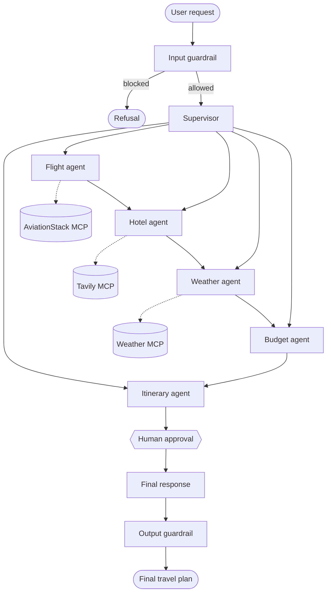

# Routewise: Multi-Agent Travel Planner

A travel planner run by a team of LLM agents. A supervisor reads the request,
decides which specialists it needs (flights, hotels, weather, budget), and an
itinerary agent drafts the trip. The draft pauses for human approval before the
final plan is written.

**Live demo:** https://multi-agent-travel-planner-eta.vercel.app

> The demo runs on free hosting. The backend sleeps when idle, so the first
> request after a break can take about a minute while it wakes up.


## Contents

- [Features](#features)
- [Architecture](#architecture)
- [Tech stack](#tech-stack)
- [Project structure](#project-structure)
- [API](#api)
- [Run locally](#run-locally)
- [Configuration](#configuration)
- [Deploy](#deploy)
- [Design notes](#design-notes)
- [Known limits](#known-limits)
- [Credits](#credits)

## Features

- **Supervisor routing.** The supervisor extracts the trip constraints and
  selects only the agents the request needs, so a weekend city break does not
  pay for a weather lookup it will not use.
- **Tool calling over MCP.** Agents reach live data through Model Context
  Protocol servers: AviationStack for flights, Tavily for hotel search, and a
  custom OpenWeather server for forecasts.
- **Human in the loop.** The graph stops at a LangGraph `interrupt` after the
  draft itinerary. The user approves it or sends feedback, and the final plan
  is written from that answer.
- **Guardrails on both sides.** NeMo Guardrails checks the user's request
  before any agent runs and checks the final plan before it is returned.
- **Follow-up questions.** Questions about a finished plan are answered with a
  single model call over the saved plan, without rerunning the agents.
- **Fails soft.** If a tool is down or the model returns malformed routing
  output, the affected section is marked unavailable and planning continues.
- **Chat interface.** A Next.js app shows the supervisor's reasoning, each
  agent's findings, the draft with an approval button, and the final plan, in
  light or dark theme.

## Architecture



The selected agents run in a fixed order (flight, hotel, weather, budget) and
any agent the supervisor did not select is skipped. Every request then goes
through the itinerary agent and the approval step.

```text
Browser (Next.js on Vercel)
   |  POST /plan, /approve, /followup
   v
FastAPI (Render)  ->  LangGraph StateGraph + checkpointer
                         |-> Groq (LLM)
                         |-> MCP servers (flights, search, weather)
                         |-> NeMo Guardrails
```

State is kept per conversation thread by a LangGraph checkpointer, which is
what lets a thread pause at the approval step and resume on a later HTTP
request.

## Tech stack

| Layer | Technology |
|---|---|
| Orchestration | LangGraph `StateGraph`, conditional routing, `interrupt` |
| Model | Groq via `langchain-groq` (default `openai/gpt-oss-20b`) |
| Tools | MCP through `langchain-mcp-adapters` (Tavily, AviationStack, custom weather server) |
| Safety | NeMo Guardrails, input and output self-check rails |
| Persistence | Postgres checkpointer when `DATABASE_URL` is set, in-memory otherwise |
| Tracing | LangSmith (optional) |
| Backend | FastAPI, Uvicorn |
| Web interface | Next.js 16, React 19, TypeScript |
| Alternative interface | Streamlit (`frontend.py`) |
| Hosting | Render (backend), Vercel (web) |

## Project structure

```text
.
├── api.py                        FastAPI endpoints around the graph
├── graph.py                      Graph definition, routing and checkpointer
├── agents.py                     Supervisor, specialist and approval nodes
├── state.py                      Shared TravelState
├── config.py                     Environment settings and model factory
├── mcp_client.py                 MCP server connections and tool calls
├── custom_weather_mcp_server.py  Weather MCP server (OpenWeather)
├── guardrails_service.py         Input and output guardrail checks
├── guardrails/                   NeMo Guardrails configuration
├── aviationstack-mcp/            Bundled AviationStack MCP server
├── frontend.py                   Streamlit interface
├── render.yaml                   Render deployment blueprint
└── web/                          Next.js chat interface
```

## API

| Endpoint | Purpose |
|---|---|
| `GET /health` | Service status and enabled features |
| `POST /plan` | Run the agents until the draft itinerary is ready |
| `POST /approve` | Approve the draft, or send feedback for the final plan |
| `POST /followup` | Answer a question about the saved plan |

Plan a trip:

```bash
curl -X POST http://localhost:8000/plan -H "Content-Type: application/json" -d '{"query": "5-day Paris romantic getaway", "user_id": "demo"}'
```

```json
{
  "thread_id": "demo_1a2b3c4d",
  "status": "awaiting_approval",
  "supervisor_reasoning": "...",
  "selected_agents": ["flight_agent", "hotel_agent", "budget_agent"],
  "flight_results": "...",
  "hotel_results": "...",
  "weather_results": "",
  "budget_results": "...",
  "draft_itinerary": "..."
}
```

`status` is `awaiting_approval`, `done`, or `blocked` (the request was stopped
by the input guardrail).

Approve the draft, or pass feedback instead:

```bash
curl -X POST http://localhost:8000/approve -H "Content-Type: application/json" -d '{"thread_id": "demo_1a2b3c4d", "approved": true, "feedback": ""}'
```

Ask a follow-up:

```bash
curl -X POST http://localhost:8000/followup -H "Content-Type: application/json" -d '{"thread_id": "demo_1a2b3c4d", "question": "What should I pack?"}'
```

Interactive API docs are served at `/docs`.

## Run locally

Requirements: Python 3.13 and Node 20 or newer.

1. Create a `.env` file in the project root with the keys listed under
   [Configuration](#configuration).

2. Start the backend:

   ```bash
   pip install -r requirements.txt
   uvicorn api:api --reload --port 8000
   ```

3. Start the web interface in a second terminal:

   ```bash
   cd web
   npm install
   npm run dev
   ```

4. Open http://localhost:3000.

To use the Streamlit interface instead, run `streamlit run frontend.py`.

## Configuration

| Variable | Required | Purpose |
|---|---|---|
| `GROQ_API_KEY` | Yes | Model calls ([console.groq.com](https://console.groq.com)) |
| `TAVILY_API_KEY` | Yes | Hotel search ([tavily.com](https://tavily.com)) |
| `AVIATIONSTACK_API_KEY` | Yes | Flight data ([aviationstack.com](https://aviationstack.com)) |
| `OPENWEATHER_API_KEY` | Yes | Weather forecasts ([openweathermap.org](https://openweathermap.org)) |
| `GROQ_MODEL` | No | Model name, default `openai/gpt-oss-20b` |
| `GROQ_MAX_RETRIES` | No | Retries on rate limits, default `6` |
| `DATABASE_URL` | No | Postgres connection string for durable checkpoints |
| `ALLOWED_ORIGINS` | No | Comma-separated CORS origins, default `*` |
| `LANGSMITH_API_KEY` | No | Enables LangSmith tracing |
| `NEXT_PUBLIC_API_URL` | No | Backend address used by the web interface |

All four services have a free tier. Keep keys in `.env` or in the host's
environment settings, never in the repository.

## Deploy

**Backend on Render.** Create a Blueprint from this repository. `render.yaml`
defines a free web service that installs `requirements.txt`, starts
`uvicorn api:api`, and health-checks `/health`. Add the four API keys as
environment variables.

**Web interface on Vercel.** Import the repository, set the project's Root
Directory to `web`, and set `NEXT_PUBLIC_API_URL` to the Render URL.

## Design notes

- **A supervisor instead of a fixed pipeline.** Routing per request keeps
  latency and token use proportional to what was asked.
- **MCP for tools.** Each data source sits behind a standard protocol, so a
  provider can be swapped without touching agent code.
- **Approval as a graph interrupt.** The pause is part of the graph state, not
  interface logic, so any client (web, Streamlit, plain HTTP) gets the same
  approval flow.
- **Bounded prompts.** Tool output is trimmed and search results are reduced to
  titles, links and short snippets before reaching the model, which keeps each
  call inside a small tokens-per-minute budget.
- **Retries where rate limits occur.** Model calls and guardrail checks back
  off and retry on rate-limit errors, and `/approve` can continue a thread that
  failed part-way.

## Known limits

- Prices are estimates produced from search results and model reasoning, not
  live bookable fares.
- Without `DATABASE_URL`, conversation state is held in memory and is lost when
  the backend restarts or goes to sleep.
- On Groq's free tier, planning several trips back to back is slow while the
  per-minute token allowance refills.
- There are no accounts. The name entered at sign-in only labels the
  conversation thread.

## Credits

`aviationstack-mcp/` is the open-source
[AviationStack MCP server](https://github.com/pradumnasaraf/aviationstack-mcp)
by Pradumna Saraf (MIT licence), bundled here unchanged.
